


 

 

CS student with a FinTech minor at Kennesaw State University and an undergraduate researcher in the First-Year Scholars Program.

I like projects that connect software to the physical world—from understanding road scenes to controlling a prosthetic hand.

Based in Alpharetta, GA. Open to internships and research opportunities, on-site or remote.

 

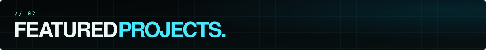

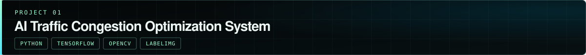

Built a computer vision proof of concept to evaluate urban traffic bottlenecks from pre-captured road imagery.

- Curated and annotated 76 high-resolution road images, targeting lane boundaries, crosswalks, and vehicle density.
- Trained a custom CNN using the Adam optimizer and dropout layers.
- Presented the proof of concept to industry partners at an Edge Solutions event.

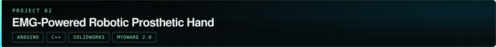

Co-led a three-person team building a prosthetic hand controlled by muscle signals.

- Built 3D-printed mechanical components with micro-servo actuation.
- Programmed Arduino control logic to translate analog signals from MyoWare 2.0 sensors into motor positions.
- Delivered the prototype hardware and code to a Georgia Tech research laboratory.

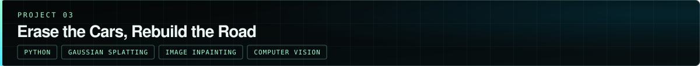

Researching 3D scene reconstruction and moving-object removal using autonomous vehicle data.

- Investigating Gaussian Splatting and multi-view image inpainting to reconstruct traffic scenes with moving vehicles removed.
- Evaluating road visibility across synchronized camera feeds.
- Cataloging frame datasets, inspecting image masks, and running controlled experiments comparing single-image filling with multi-view reconstruction.

 

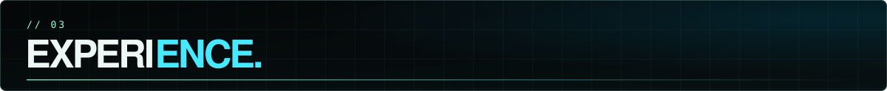

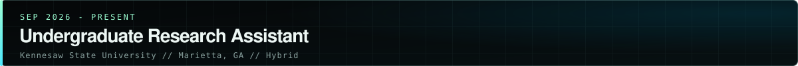

Selected for the First-Year Scholars Program under Dr. Soomok Lee. Working on the scene-reconstruction research featured above.

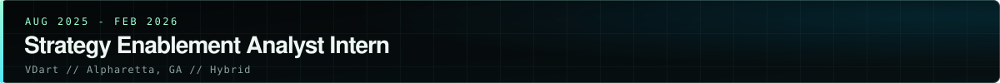

- Designed and prototyped AI chatbot concepts for potential integration across internal company channels.
- Developed early-stage proof-of-concept workflows for AI content automation and agentic applications.
- Collaborated across agile development sprints to support the enterprise Marketing Academy platform rollout.

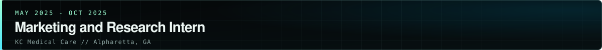

- Designed and launched HTML/CSS web pages for multiple clinical branches.
- Collected and structured local market data to support localized SEO and social media outreach.
- Maintained confidentiality across patient-facing marketing assets and documentation.

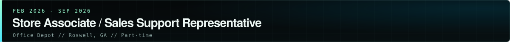

Provided technical troubleshooting and hardware/software recommendations, explaining solutions clearly to non-technical customers in a high-traffic retail setting.

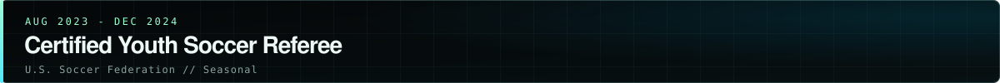

Officiated competitive youth matches, enforced safety standards, and resolved on-field disputes under pressure.

 

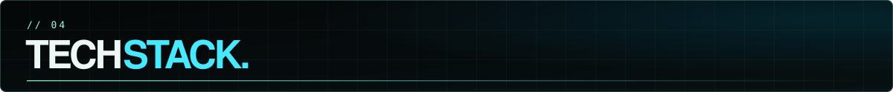

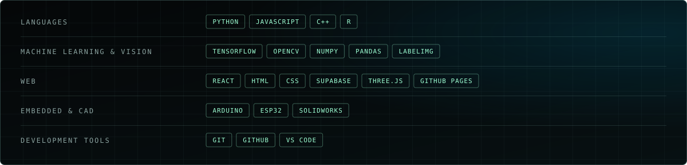

 

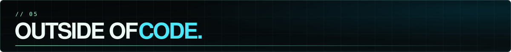

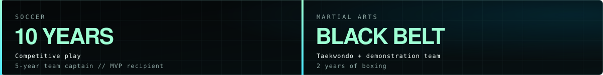

 

  <i>Learn by building. Ship it. Repeat.</i>

